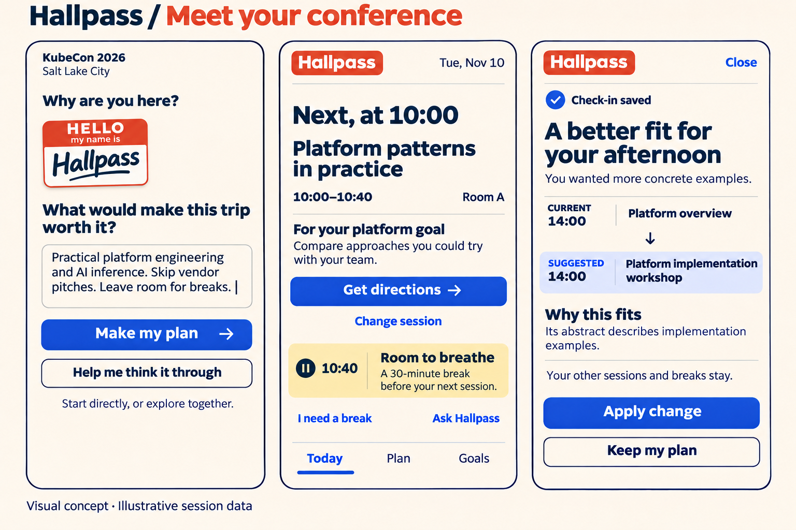

# Hallpass design handoff

## Current direction

[HELLO badge concept, v3](hallpass-hello-badge-v3.png) is the current accepted visual direction: a quieter opening badge, warm ivory surfaces, navy text, cobalt actions, and a yellow planned-break treatment.

These are static design references, not implemented screens. The three visual screens cover Entry, Today, and Plan adjustment. The remaining screens still need the selected style applied; a complete component/state specification is not yet supplied.

## Read in this order

1. [End-to-end walkthrough](02-demo-walkthrough.md): current demo persona, screen behavior, supporting surfaces, and narrated video target of 2:45.
2. [Wireframe board](hallpass-wireframes-v1.png): eight-screen structure, including optional exploration. Follow the walkthrough's annotations where the image is simplified.
3. [HELLO badge direction](04-hello-badge-direction.md): visual intent and the understated v3 refinement.

The intake must support direct, focused input and optional guided exploration. Do not require everyone to complete a fixed conversation or three-step form. The build plan's older mandatory three-step intake decision conflicts with this later user-approved UX direction and needs reconciliation by the intake owner; this documentation PR does not change contracts or implementation.

Keep both check-in questions. The walkthrough calls out the explicit Save action's additional tap. Proposed plan changes are reviewed before applying. Session titles, rooms, and outcomes in images are illustrative and must be replaced with supported agenda data before the recording.

## Earlier explorations

- [Initial flow draft](01-flows-and-wireframes.md): historical exploration; current walkthrough takes precedence.
- [Teal visual proposal](03-visual-direction.md) and [v1 image](hallpass-visual-direction-v1.png): superseded by the HELLO badge direction.
- [Large badge v2](hallpass-hello-badge-v2.png): superseded by the quieter v3 opening.

Generation prompts are retained alongside the images for provenance and future revisions. Raster mockups do not establish exact fonts, measured accessibility, responsive behavior, or reusable vector logo assets.
